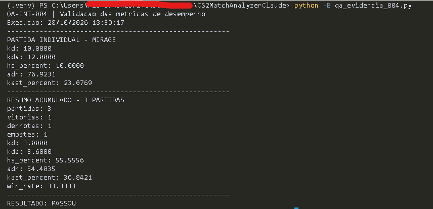
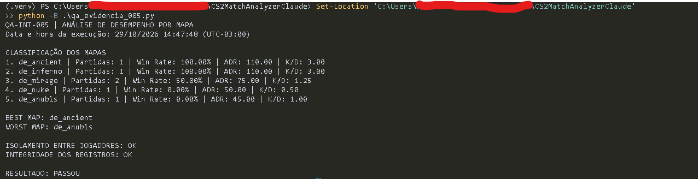

# Registro de testes — CS2 Match Analyzer

Documentação dos cenários de integração do **CS2 Match Analyzer**, projeto em Python e SQLite voltado ao registro e à consulta de partidas de Counter-Strike 2, com foco em integridade de dados e Quality Assurance (QA).

## Visão geral

| ID | Cenário | Natureza | Data | Resultado |
| --- | --- | --- | --- | --- |
| **QA-INT-001** | Integridade da transação (rollback) | Negativo | 21/10/2026 | **PASSOU** |
| **QA-INT-002** | Registro de transação válida | Positivo | 21/10/2026 | **PASSOU** |
| **QA-INT-003** | Consulta do histórico por jogador | Positivo / isolamento de dados | 28/10/2026 | **PASSOU** |
| **QA-INT-004** | Validação das métricas de desempenho | Cálculos individuais e acumulados | 28/10/2026 | **PASSOU** |
| **QA-INT-005** | Análise de desempenho por mapa | Agregação, classificação e isolamento | 29/10/2026 | **PASSOU** |

**Ambiente:** Python 3.12 e SQLite em memória.

**Execução:** cenários realizados manualmente e reexecutados por scripts Python iniciados pelo terminal, com verificações por `assert`.

**Escopo:** integração entre as funções Python e o banco SQLite; as capturas abaixo são evidências das execuções dos cenários.

---

## QA-INT-001 — Integridade de transação (rollback)

| Campo | Detalhe |
| --- | --- |
| Tipo | Teste de integração — cenário negativo |
| Prioridade | Alta |
| Data da execução | 21/10/2026 |
| Status | **PASSOU** |

### Objetivo

Verificar se uma performance inválida provoca o rollback da partida inserida na mesma transação, sem desfazer o cadastro do jogador confirmado anteriormente.

### Pré-condições

- Banco SQLite de teste inicializado em memória, com regras de integridade habilitadas.
- Funções `registrar_partida()` e `registrar_performance()` disponíveis.
- Jogador `jogador_teste` previamente cadastrado e confirmado com `commit()`.

### Procedimento

1. Iniciar uma transação com `with conn`.
2. Registrar uma partida válida na Mirage (`de_mirage`), com vitória por **13 × 7**.
3. Tentar registrar uma performance com **5 kills** e **6 headshots**.
4. Capturar a exceção `sqlite3.IntegrityError`.
5. Consultar as quantidades de registros em `player`, `partida` e `performance` após a falha.

### Resultado esperado

- A inserção da performance deve ser rejeitada por violar `headshots <= kills`.
- A partida inserida na mesma transação deve ser desfeita.
- O jogador anteriormente confirmado deve permanecer cadastrado.
- Contagens finais: **1 jogador, 0 partidas e 0 performances**.

### Resultado obtido

| Verificação | Resultado |
| --- | --- |
| Exceção | `CHECK constraint failed: headshots <= kills` |
| Jogadores | `1` |
| Partidas | `0` |
| Performances | `0` |
| Resultado do script | `RESULTADO: PASSOU` |

### Conclusão

**PASSOU.** O SQLite rejeitou a performance inválida e a transação foi revertida. A partida não permaneceu registrada, enquanto o jogador previamente confirmado foi preservado.

### Evidência de execução

Reexecução em **21/10/2026, às 16:15:31**, por meio do script `qa_evidencia_001.py`, iniciado manualmente no terminal.

---

## QA-INT-002 — Registro de transação válida

| Campo | Detalhe |
| --- | --- |
| Tipo | Teste de integração — cenário positivo |
| Prioridade | Alta |
| Data da execução | 21/10/2026 |
| Status | **PASSOU** |

### Objetivo

Verificar o registro de uma partida e da performance do jogador na mesma transação, incluindo a conferência dos relacionamentos entre as tabelas por SQL `JOIN`.

### Pré-condições

- Banco SQLite de teste inicializado em memória, com chaves estrangeiras habilitadas.
- Funções `registrar_partida()` e `registrar_performance()` disponíveis.
- Jogador `jogador_teste` previamente cadastrado e confirmado com `commit()`.

### Procedimento

1. Iniciar uma transação com `with conn`.
2. Registrar uma partida na Inferno (`de_inferno`), com vitória por **13 × 9**.
3. Registrar a performance vinculada à partida: **20 kills**, **15 deaths**, **5 assists**, **10 headshots** e **22 rounds**.
4. Encerrar o bloco de transação sem exceções.
5. Consultar as contagens em `player`, `partida` e `performance`.
6. Executar um SQL `JOIN` para conferir jogador, mapa e estatísticas.
7. Verificar `conn.in_transaction`.

### Resultado esperado

- Partida e performance inseridas com IDs válidos.
- Contagens finais: **1 jogador, 1 partida e 1 performance**.
- SQL `JOIN` retornando o jogador, o mapa e as estatísticas esperadas.
- `conn.in_transaction` igual a `False` ao final.

### Resultado obtido

| Verificação | Resultado |
| --- | --- |
| Partida ID | `1` |
| Performance ID | `1` |
| Jogadores / partidas / performances | `1 / 1 / 1` |
| SQL `JOIN` | `('jogador_teste', 'de_inferno', 20, 15, 10)` |
| Transação aberta | `False` |
| Resultado do script | `RESULTADO: PASSOU` |

### Conclusão

**PASSOU.** As inserções ocorreram sem erros, os registros estavam presentes e a consulta SQL confirmou a associação correta entre jogador, partida e performance. Não havia transação pendente ao final da execução.

### Evidência de execução

Reexecução em **21/10/2026, às 16:34:38**, por meio do script `qa_evidencia_002.py`, iniciado manualmente no terminal.

---

## QA-INT-003 — Consulta do histórico de partidas por jogador

| Campo | Detalhe |
| --- | --- |
| Tipo | Teste de integração — cenário positivo e isolamento de dados |
| Prioridade | Alta |
| Data da execução | 28/10/2026 |
| Status | **PASSOU** |

### Objetivo

Verificar se `listar_partidas()` retorna somente as partidas associadas ao jogador solicitado, ordenadas por data decrescente e, em caso de empate, por ID decrescente, sem misturar estatísticas entre jogadores.

### Pré-condições

- Banco SQLite de teste inicializado em memória.
- Funções `registrar_partida()`, `registrar_performance()` e `listar_partidas()` disponíveis.
- IDs de jogador utilizados no cenário: `jogador_teste`, `colega` e um ID inexistente (`999`).

### Procedimento

1. Cadastrar os jogadores `jogador_teste` e `colega`.
2. Registrar três partidas: Mirage em **20/10/2026**, Inferno em **22/10/2026** e Nuke em **22/10/2026**.
3. Associar as três partidas ao `jogador_teste`, com **20, 14 e 18 kills**, respectivamente.
4. Associar somente a partida Inferno ao `colega`, com **25 kills**.
5. Executar `listar_partidas()` para cada jogador e para o ID inexistente `999`.
6. Comparar a ordenação, os IDs e os valores de kills com os resultados esperados usando `assert`.

### Resultado esperado

- `jogador_teste`: partidas **3 → 2 → 1** (Nuke, Inferno e Mirage), com **18, 14 e 20 kills**, respectivamente.
- `colega`: somente a partida **2**, na Inferno, com **25 kills**.
- ID `999`: lista vazia (`[]`).
- Nenhuma mistura de partidas ou estatísticas entre jogadores.

### Resultado obtido

| Jogador | Partida | Mapa | Kills |
| --- | ---: | --- | ---: |
| `jogador_teste` | `3` | `de_nuke` | `18` |
| `jogador_teste` | `2` | `de_inferno` | `14` |
| `jogador_teste` | `1` | `de_mirage` | `20` |
| `colega` | `2` | `de_inferno` | `25` |

**Jogador inexistente:** `[]`

**Resultado do script:** `RESULTADO: PASSOU`

### Conclusão

**PASSOU.** A consulta retornou as partidas do jogador solicitado na ordem esperada, respeitou o desempate por ID e manteve as estatísticas dos jogadores separadas. A consulta ao ID inexistente retornou uma lista vazia.

### Evidência de execução

Execução em **28/10/2026, às 16:10:17**, por meio do script `qa_evidencia_003.py`, iniciado manualmente no terminal.

---

## QA-INT-004 — Validação das métricas de desempenho

| Campo | Detalhe |
| --- | --- |
| Tipo | Teste de integração |
| Prioridade | Alta |
| Data da aprovação | 28/10/2026, às 18:39:17 |
| Status | **PASSOU** |

### Objetivo

Validar o cálculo individual e acumulado de K/D, KDA, HS%, ADR, KAST% e Win Rate.

### Pré-condições

- Banco SQLite de teste inicializado em memória.
- Funções `obter_metricas_partida()` e `obter_resumo_jogador()` disponíveis.
- Três partidas associadas ao jogador: uma vitória, uma derrota e um empate.

### Procedimento

1. Consultar as métricas individuais e o resumo acumulado do jogador.
2. Conferir os valores calculados usando `assert`.
3. Verificar a proteção contra divisão por zero em K/D e KDA na partida sem mortes, usando o denominador `max(1, deaths)`.
4. Verificar que as razões agregadas utilizam os totais, em vez da média das métricas individuais.
5. Verificar o retorno `None` para associações inexistentes.

### Resultado esperado

- Resumo com **3 partidas, 1 vitória, 1 derrota e 1 empate**.
- Métricas individuais e acumuladas coerentes com os dados registrados.
- Derrotas e empates incluídos no denominador do Win Rate.
- K/D e KDA protegidos na situação de zero mortes.
- Retorno `None` quando não existe performance associada aos IDs informados.

### Resultado obtido

| Métrica do resumo | Resultado |
| --- | --- |
| K/D | `3.0` |
| KDA | `3.6` |
| HS% | `55.5555...` |
| ADR | `54.4035...` |
| KAST% | `36.8421...` |
| Win Rate | `33.3333...` |

Os valores foram validados por `assert` com `math.isclose`, incluindo proteção contra divisão por zero mortes, cálculos agregados pelos totais e retorno `None` para associações inexistentes. As reticências representam a exibição abreviada dos decimais; as funções não arredondam os resultados. A proteção de HS% para zero kills (`0.0`) é coberta pela suíte automatizada, separadamente deste cenário de três partidas.

### Conclusão

**PASSOU.** O cenário validou as métricas individuais e acumuladas, as convenções para divisão por zero e os retornos para associações inexistentes. Aprovação em **28/10/2026, às 18:39:17**.

### Evidência de execução

---

## QA-INT-005 — Análise de desempenho por mapa

| Campo | Detalhe |
| --- | --- |
| Tipo | Teste de integração — agregação, classificação e isolamento |
| Prioridade | Alta |
| Data da execução | 29/10/2026, às 14:47:48 (UTC−03:00) |
| Status | **PASSOU** |

### Objetivo

Validar as estatísticas agregadas por mapa, a classificação Best/Worst Map,
o isolamento entre jogadores e a integridade dos registros após as consultas.

### Pré-condições

- Python 3.12, banco SQLite em memória criado com `connect()` e `init_db()`.
- Funções reais `registrar_partida()`, `registrar_performance()`,
  `obter_estatisticas_mapas()`, `obter_melhor_mapa()` e `obter_pior_mapa()` disponíveis.
- Script independente `qa_evidencia_005.py`, executado com asserts habilitados.
- Dois jogadores cadastrados, seis partidas do principal em cinco mapas e uma
  performance do segundo jogador na vitória compartilhada em Mirage.

### Dados de teste

| Mapa | Resultado | Placar | Kills | Deaths | Assists | HS | Damage | KAST rounds |
| --- | --- | --- | ---: | ---: | ---: | ---: | ---: | ---: |
| de_ancient | Vitória | 13 × 7 | 15 | 5 | 3 | 5 | 2200 | 12 |
| de_inferno | Vitória | 13 × 7 | 30 | 10 | 4 | 15 | 2200 | 16 |
| de_mirage | Vitória | 13 × 7 | 20 | 10 | 5 | 10 | 2000 | 15 |
| de_mirage | Derrota | 7 × 13 | 5 | 10 | 1 | 1 | 1000 | 8 |
| de_nuke | Derrota | 7 × 13 | 10 | 20 | 3 | 5 | 1000 | 10 |
| de_anubis | Empate | 10 × 10 | 10 | 10 | 2 | 2 | 900 | 9 |

O segundo jogador possui 40 kills, 2 deaths, 8 assists, 30 HS, 4000 damage,
20 rounds e 20 KAST rounds na vitória em Mirage. Os demais campos são válidos
no schema. Totais do banco: dois jogadores, seis partidas e sete performances.

### Procedimento

1. Executar `python -B .\qa_evidencia_005.py` no PowerShell, na raiz do projeto.
2. Inicializar o banco em memória, inserir os dados com as funções reais e confirmar a transação.
3. Guardar o estado dos registros, o contador de alterações e o estado transacional.
4. Consultar a classificação, Best Map e Worst Map do jogador principal.
5. Conferir cinco mapas, seis partidas e a ordem exata com `assert`.
6. Conferir contagens e métricas agregadas de Mirage, usando `math.isclose()` nos decimais.
7. Consultar o segundo jogador e conferir seu resumo independente e seus Best/Worst Maps.
8. Verificar `[]`/`None` para jogador inexistente e comparar os registros e o estado transacional após as consultas.
9. Exibir a classificação e `RESULTADO: PASSOU` somente após todos os asserts.

### Resultado esperado

Classificação por Win Rate decrescente, ADR decrescente, K/D decrescente e nome
crescente. Best Map deve ser `de_ancient`, pelo desempate alfabético com Inferno;
Worst Map deve ser `de_anubis`, pelo menor ADR entre os mapas com Win Rate zero.

| Posição | Mapa | Partidas | Win Rate | ADR | K/D |
| ---: | --- | ---: | ---: | ---: | ---: |
| 1 | de_ancient | 1 | 100% | 110 | 3 |
| 2 | de_inferno | 1 | 100% | 110 | 3 |
| 3 | de_mirage | 2 | 50% | 75 | 1,25 |
| 4 | de_nuke | 1 | 0% | 50 | 0,5 |
| 5 | de_anubis | 1 | 0% | 45 | 1 |

Mirage deve apresentar duas partidas, uma vitória, uma derrota e nenhum empate;
K/D 1,25, KDA 1,55, HS% 44%, ADR 75, KAST% 57,5% e Win Rate 50%, calculados
pelos totais (25 kills, 20 deaths, 6 assists, 11 HS, 3000 damage, 40 rounds e
23 KAST rounds). A performance do segundo jogador não pode contaminar esses valores.

### Resultado obtido

A classificação obtida correspondeu integralmente à tabela esperada acima.
Todos os asserts foram concluídos com sucesso, incluindo os valores agregados de
Mirage. A captura do terminal foi revisada e aprovada pelo QA Lead, conforme
validação comunicada pelo usuário.

| Verificação | Resultado |
| --- | --- |
| Mapas / partidas do principal | `5 / 6` |
| Best Map | `de_ancient` |
| Worst Map | `de_anubis` |
| Segundo jogador | Somente Mirage, uma vitória; K/D 20, KDA 24, HS% 75%, ADR 200, KAST% 100%, Win Rate 100% |
| Isolamento entre jogadores | `OK` |
| Integridade dos registros | `OK`; registros, total_changes e estado transacional preservados |
| Jogador inexistente | Lista vazia e Best/Worst `None` |
| Resultado do script | `RESULTADO: PASSOU` |

### Conclusão

**PASSOU.** Execução manual pelo usuário em **29/10/2026, às 14:47:48
(UTC−03:00)**. Cenário aprovado pelo QA Lead após revisão da captura do terminal.

### Evidência de execução

Arquivo `docs/evidencias/QA-INT-005.png` confirmado no workspace.

---

## Limitações e observações

- Os cinco cenários foram executados em **SQLite em memória**; eles não validam a persistência após fechar e reabrir um banco em arquivo.
- Os casos cobrem os comportamentos específicos descritos, sem representar cobertura completa das funcionalidades.
- As capturas de QA-INT-001 e QA-INT-002 documentam reexecuções dos cenários originalmente realizados no console interativo.
- Os scripts de evidência foram executados localmente e, até esta revisão, não fazem parte do repositório publicado.
- A suíte automatizada do projeto é **separada** destes cinco cenários manuais documentados: **195 testes aprovados localmente**, sendo **167 anteriores preservados e 28 novos testes de análise por mapa**. Os 195 testes ainda não foram validados no GitHub Actions. A manutenção da base `0c17c96` já foi aprovada remotamente com 167 testes e 100% de cobertura Python, conforme validação informada pelo usuário. O commit `289c378` também teve os 138 testes aprovados no GitHub Actions: [execução confirmada de 28/10/2026](https://github.com/kwe-nascimento/cs2-match-analyzer/actions/runs/40775358994).

## Resultado geral

**5 cenários de integração executados — 5 aprovados — nenhuma falha identificada nos comportamentos avaliados.**

A documentação reúne procedimentos, resultados esperados, resultados obtidos e evidências visuais para apoiar a revisão técnica e a evolução do portfólio de QA.
