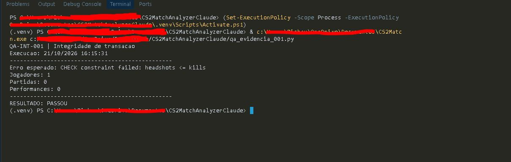
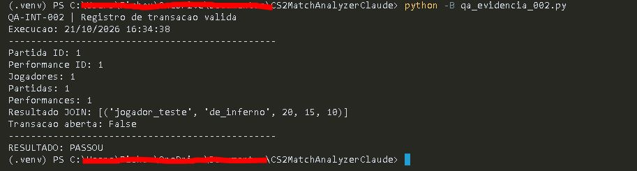
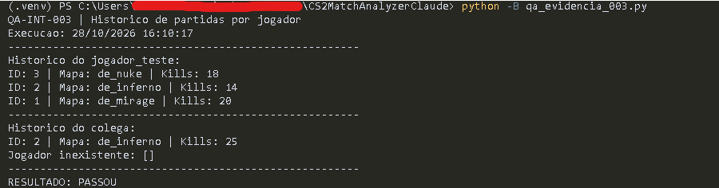

# Registro de testes — CS2 Match Analyzer

Documentação dos cenários de integração do **CS2 Match Analyzer**, projeto em Python e SQLite voltado ao registro e à consulta de partidas de Counter-Strike 2, com foco em integridade de dados e Quality Assurance (QA).

## Visão geral

| ID | Cenário | Natureza | Data | Resultado |
| --- | --- | --- | --- | --- |
| **QA-INT-001** | Integridade da transação (rollback) | Negativo | 21/10/2026 | **PASSOU** |
| **QA-INT-002** | Registro de transação válida | Positivo | 21/10/2026 | **PASSOU** |
| **QA-INT-003** | Consulta do histórico por jogador | Positivo / isolamento de dados | 28/10/2026 | **PASSOU** |

**Ambiente:** Python 3.12 e SQLite em memória.

**Execução:** cenários realizados manualmente e reexecutados por scripts Python iniciados pelo terminal, com verificações por `assert`.

**Escopo:** integração entre as funções Python e o banco SQLite; as capturas abaixo são evidências das execuções dos cenários.

---

## QA-INT-001 — Integridade de transação (rollback)

| Campo | Detalhe |
| --- | --- |
| Tipo | Teste de integração — cenário negativo |
| Prioridade | Alta |
| Data da execução | 21/10/2026 |
| Status | **PASSOU** |

### Objetivo

Verificar se uma performance inválida provoca o rollback da partida inserida na mesma transação, sem desfazer o cadastro do jogador confirmado anteriormente.

### Pré-condições

- Banco SQLite de teste inicializado em memória, com regras de integridade habilitadas.
- Funções `registrar_partida()` e `registrar_performance()` disponíveis.
- Jogador `jogador_teste` previamente cadastrado e confirmado com `commit()`.

### Procedimento

1. Iniciar uma transação com `with conn`.
2. Registrar uma partida válida na Mirage (`de_mirage`), com vitória por **13 × 7**.
3. Tentar registrar uma performance com **5 kills** e **6 headshots**.
4. Capturar a exceção `sqlite3.IntegrityError`.
5. Consultar as quantidades de registros em `player`, `partida` e `performance` após a falha.

### Resultado esperado

- A inserção da performance deve ser rejeitada por violar `headshots <= kills`.
- A partida inserida na mesma transação deve ser desfeita.
- O jogador anteriormente confirmado deve permanecer cadastrado.
- Contagens finais: **1 jogador, 0 partidas e 0 performances**.

### Resultado obtido

| Verificação | Resultado |
| --- | --- |
| Exceção | `CHECK constraint failed: headshots <= kills` |
| Jogadores | `1` |
| Partidas | `0` |
| Performances | `0` |
| Resultado do script | `RESULTADO: PASSOU` |

### Conclusão

**PASSOU.** O SQLite rejeitou a performance inválida e a transação foi revertida. A partida não permaneceu registrada, enquanto o jogador previamente confirmado foi preservado.

### Evidência de execução

Reexecução em **21/10/2026, às 16:15:31**, por meio do script `qa_evidencia_001.py`, iniciado manualmente no terminal.

---

## QA-INT-002 — Registro de transação válida

| Campo | Detalhe |
| --- | --- |
| Tipo | Teste de integração — cenário positivo |
| Prioridade | Alta |
| Data da execução | 21/10/2026 |
| Status | **PASSOU** |

### Objetivo

Verificar o registro de uma partida e da performance do jogador na mesma transação, incluindo a conferência dos relacionamentos entre as tabelas por SQL `JOIN`.

### Pré-condições

- Banco SQLite de teste inicializado em memória, com chaves estrangeiras habilitadas.
- Funções `registrar_partida()` e `registrar_performance()` disponíveis.
- Jogador `jogador_teste` previamente cadastrado e confirmado com `commit()`.

### Procedimento

1. Iniciar uma transação com `with conn`.
2. Registrar uma partida na Inferno (`de_inferno`), com vitória por **13 × 9**.
3. Registrar a performance vinculada à partida: **20 kills**, **15 deaths**, **5 assists**, **10 headshots** e **22 rounds**.
4. Encerrar o bloco de transação sem exceções.
5. Consultar as contagens em `player`, `partida` e `performance`.
6. Executar um SQL `JOIN` para conferir jogador, mapa e estatísticas.
7. Verificar `conn.in_transaction`.

### Resultado esperado

- Partida e performance inseridas com IDs válidos.
- Contagens finais: **1 jogador, 1 partida e 1 performance**.
- SQL `JOIN` retornando o jogador, o mapa e as estatísticas esperadas.
- `conn.in_transaction` igual a `False` ao final.

### Resultado obtido

| Verificação | Resultado |
| --- | --- |
| Partida ID | `1` |
| Performance ID | `1` |
| Jogadores / partidas / performances | `1 / 1 / 1` |
| SQL `JOIN` | `('jogador_teste', 'de_inferno', 20, 15, 10)` |
| Transação aberta | `False` |
| Resultado do script | `RESULTADO: PASSOU` |

### Conclusão

**PASSOU.** As inserções ocorreram sem erros, os registros estavam presentes e a consulta SQL confirmou a associação correta entre jogador, partida e performance. Não havia transação pendente ao final da execução.

### Evidência de execução

Reexecução em **21/10/2026, às 16:34:38**, por meio do script `qa_evidencia_002.py`, iniciado manualmente no terminal.

---

## QA-INT-003 — Consulta do histórico de partidas por jogador

| Campo | Detalhe |
| --- | --- |
| Tipo | Teste de integração — cenário positivo e isolamento de dados |
| Prioridade | Alta |
| Data da execução | 28/10/2026 |
| Status | **PASSOU** |

### Objetivo

Verificar se `listar_partidas()` retorna somente as partidas associadas ao jogador solicitado, ordenadas por data decrescente e, em caso de empate, por ID decrescente, sem misturar estatísticas entre jogadores.

### Pré-condições

- Banco SQLite de teste inicializado em memória.
- Funções `registrar_partida()`, `registrar_performance()` e `listar_partidas()` disponíveis.
- IDs de jogador utilizados no cenário: `jogador_teste`, `colega` e um ID inexistente (`999`).

### Procedimento

1. Cadastrar os jogadores `jogador_teste` e `colega`.
2. Registrar três partidas: Mirage em **20/10/2026**, Inferno em **22/10/2026** e Nuke em **22/10/2026**.
3. Associar as três partidas ao `jogador_teste`, com **20, 14 e 18 kills**, respectivamente.
4. Associar somente a partida Inferno ao `colega`, com **25 kills**.
5. Executar `listar_partidas()` para cada jogador e para o ID inexistente `999`.
6. Comparar a ordenação, os IDs e os valores de kills com os resultados esperados usando `assert`.

### Resultado esperado

- `jogador_teste`: partidas **3 → 2 → 1** (Nuke, Inferno e Mirage), com **18, 14 e 20 kills**, respectivamente.
- `colega`: somente a partida **2**, na Inferno, com **25 kills**.
- ID `999`: lista vazia (`[]`).
- Nenhuma mistura de partidas ou estatísticas entre jogadores.

### Resultado obtido

| Jogador | Partida | Mapa | Kills |
| --- | ---: | --- | ---: |
| `jogador_teste` | `3` | `de_nuke` | `18` |
| `jogador_teste` | `2` | `de_inferno` | `14` |
| `jogador_teste` | `1` | `de_mirage` | `20` |
| `colega` | `2` | `de_inferno` | `25` |

**Jogador inexistente:** `[]`

**Resultado do script:** `RESULTADO: PASSOU`

### Conclusão

**PASSOU.** A consulta retornou as partidas do jogador solicitado na ordem esperada, respeitou o desempate por ID e manteve as estatísticas dos jogadores separadas. A consulta ao ID inexistente retornou uma lista vazia.

### Evidência de execução

Execução em **28/10/2026, às 16:10:17**, por meio do script `qa_evidencia_003.py`, iniciado manualmente no terminal.

---

## Limitações e observações

- Os três cenários foram executados em **SQLite em memória**; eles não validam a persistência após fechar e reabrir um banco em arquivo.
- Os casos cobrem os comportamentos específicos descritos, sem representar cobertura completa das funcionalidades.
- As capturas de QA-INT-001 e QA-INT-002 documentam reexecuções dos cenários originalmente realizados no console interativo.
- Os scripts de evidência foram executados localmente e, até esta revisão, não fazem parte do repositório publicado.
- A suíte automatizada do projeto é **separada** destes três cenários documentados: **116 testes aprovados localmente** após a implementação da consulta, enquanto a última execução publicada no GitHub Actions ainda corresponde à versão anterior com **108 testes aprovados**.

## Resultado geral

**3 cenários de integração executados — 3 aprovados — nenhuma falha identificada nos comportamentos avaliados.**

A documentação reúne procedimentos, resultados esperados, resultados obtidos e evidências visuais para apoiar a revisão técnica e a evolução do portfólio de QA.
